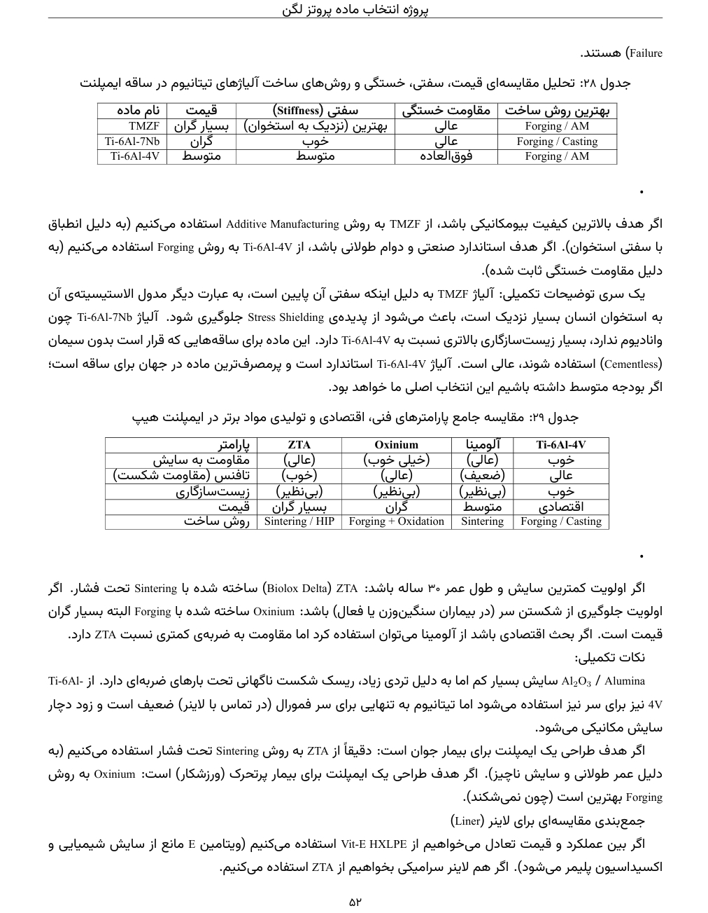
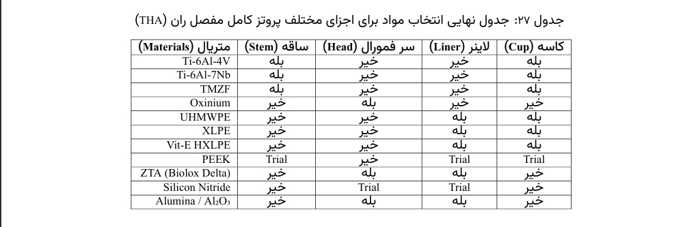
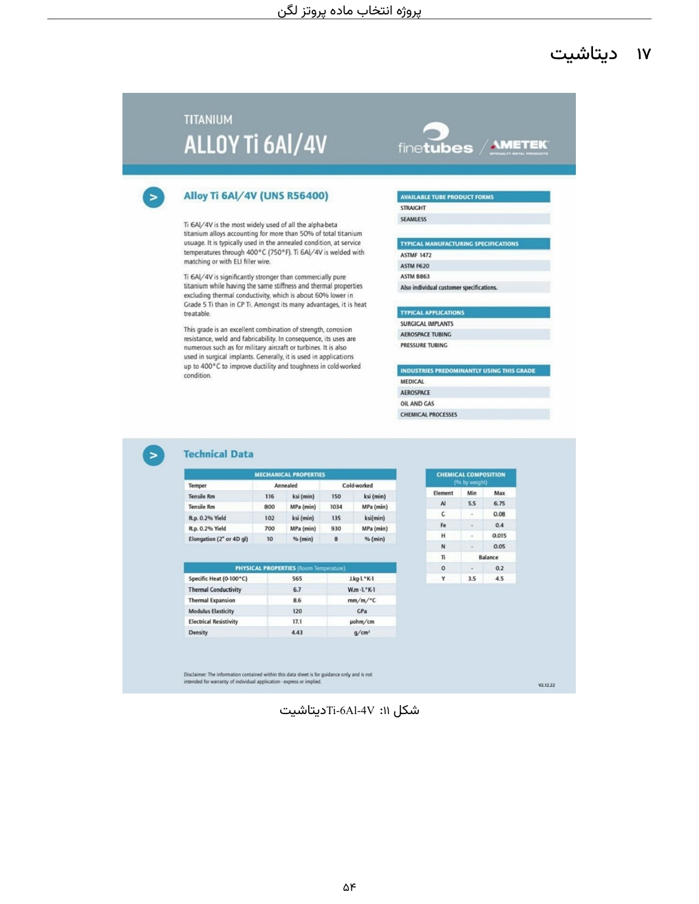

# Hip Implant Material Selection

## 1. Project Overview

This project focuses on engineering material selection for total hip replacement implants. It compares candidate materials based on their mechanical properties, wear resistance, biocompatibility, manufacturing requirements, and cost.

The objective is to identify suitable materials for different components of a hip implant through technical comparison and evaluation of material properties.

## 2. Implant Components and Material Families

The project considers materials from three major families:

- **Metals:** Titanium alloys and other metallic implant materials
- **Polymers:** Polymeric materials used in bearing components
- **Ceramics:** Ceramic materials considered for wear-resistant implant surfaces

Material requirements vary by component, so selection must account for the function and operating conditions of each part.

## 3. Technical Comparison

Candidate materials are evaluated using engineering properties and practical selection criteria, including mechanical performance, wear behavior, manufacturing methods, and economic considerations.

*Figure 1. Technical comparison of candidate materials from the original project report.*

## 4. Final Material Selection

The final selection stage compares candidate materials against the requirements of the implant components.

*Figure 2. Final material selection results from the project report.*

## 5. Material Datasheet

Material datasheets provide supporting information for evaluating candidate materials and comparing their properties.

*Figure 3. Material datasheet included in the original project report.*

## 6. Engineering Topics and Skills

- Engineering materials selection
- Biomaterials and orthopedic implants
- Comparison of mechanical properties
- Wear resistance and fatigue considerations
- Manufacturing process selection
- Technical datasheet interpretation
- Engineering decision-making

## 7. Complete Project Report

The complete report is available in Persian and contains the project's background, material comparisons, selection results, and supporting technical information.

[View or download the complete project report (PDF)](./MaterialSelection.pdf)
